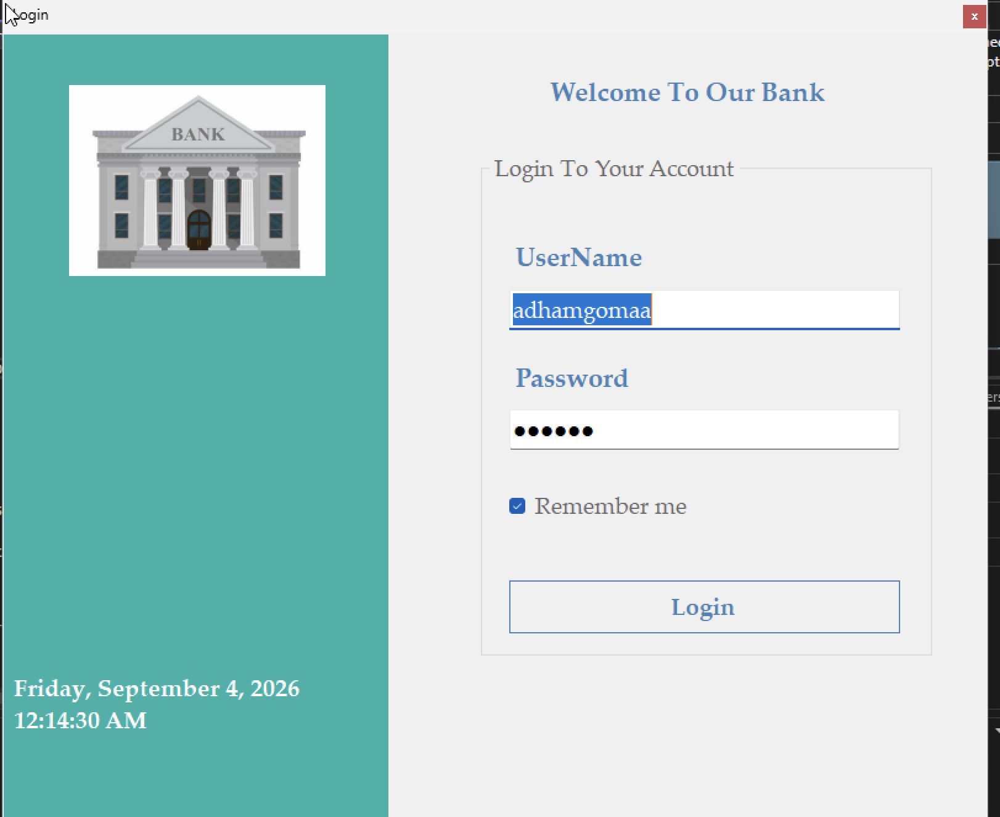
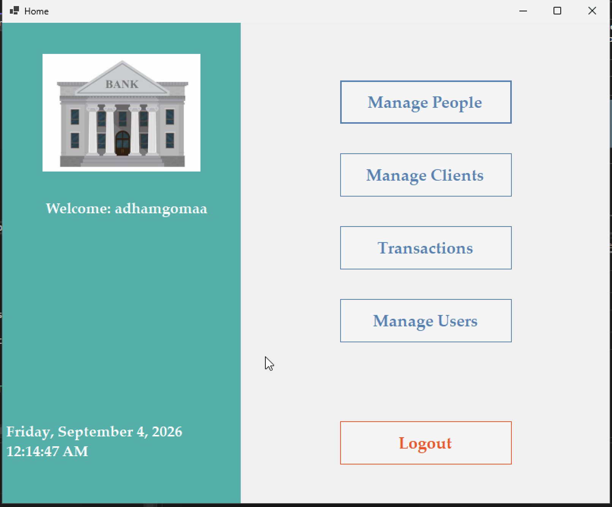
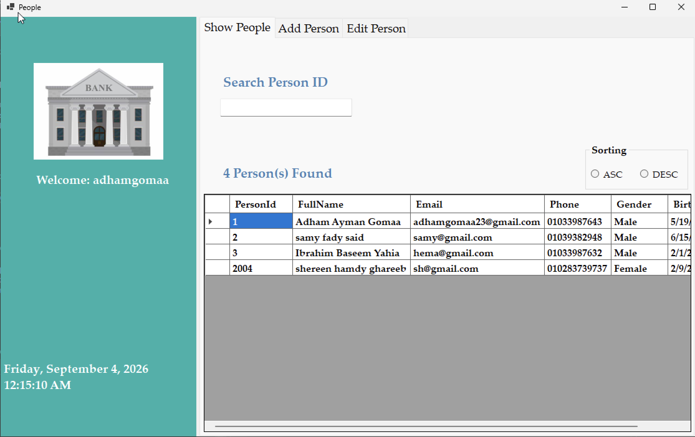
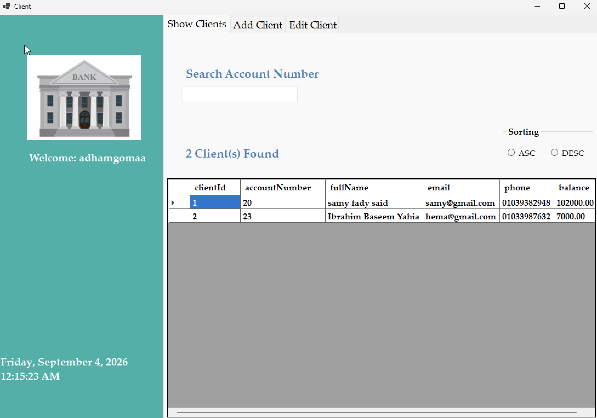
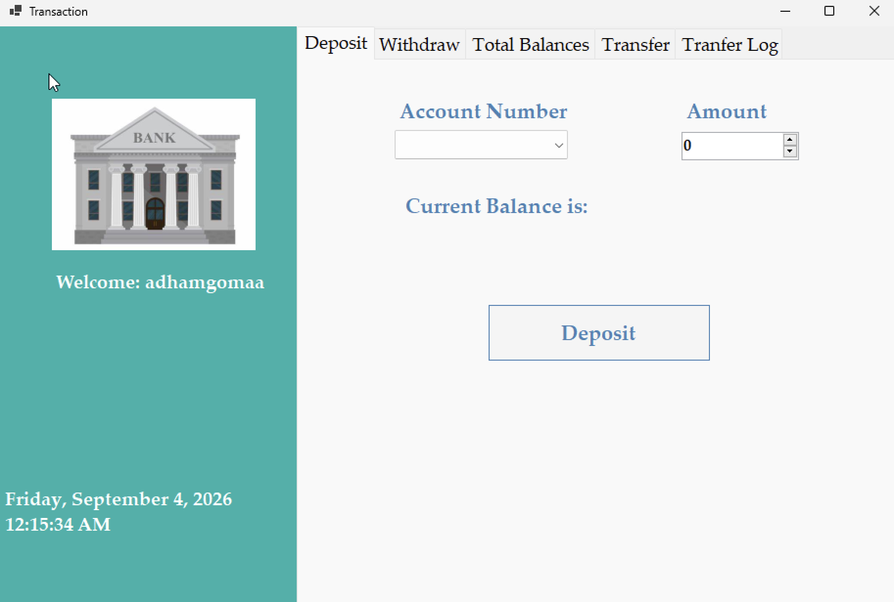
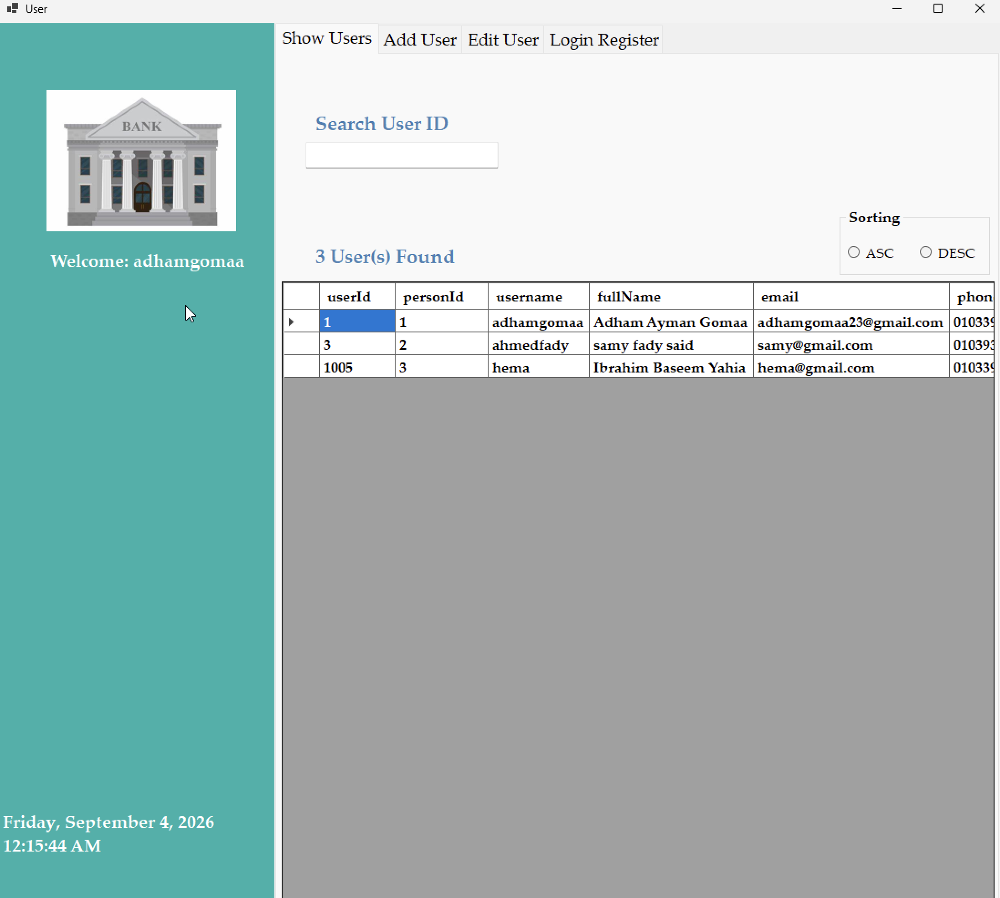

# 🏦 Bank System v2


A modern bank management system built with C#, Windows Forms, ASP.NET Core Web API, and SQL Server. The project follows a layered client-server architecture where the desktop application speaks to a secure REST API instead of accessing the database directly.

This version improves maintainability by separating responsibilities into business logic, data access, DTOs, and API layers.

---

# 📌 Overview

The application is designed for bank operations and employee workflows, including:

- People management
- User management
- Client and account management
- Deposits and withdrawals
- Internal transfers
- Login and access auditing
- Permission-based authorization

The system is structured into multiple layers to keep the desktop UI, business rules, and persistence logic cleanly separated.

---

# ✨ Features

## Authentication and security

- JWT-based authentication
- Refresh token flow
- Secure login and logout endpoints
- Password validation and hashed credentials handling
- Role/permission-based authorization
- Rate limiting on sensitive endpoints
- Login attempt tracking for audit and protection

## User management

- Create users
- Update users
- Delete users
- Search by ID or username
- List all users
- View user permissions and activity status

## People management

- Add people records
- Update people records
- List and search people
- Track personal information linked to users and clients

## Client and account management

- Add new clients
- Update client details
- Search by ID or account number
- View client balance
- Get total bank balances
- Deposit and withdraw operations
- Account existence and validation checks

## Transfer management

- Record transfer transactions
- Fetch transfer history
- Validate sender/receiver account data
- Track transaction information with user references

## Audit and admin features

- Login attempt history
- User activity and audit fields
- Permission policy enforcement
- Full access controls for administrative operations

---

# 🏗️ Architecture

```text
+---------------------+
| WinForms Client     |
| BankSystem.WinForms |
+----------+----------+
           |
           | HTTP / API calls
           v
+---------------------+
| ASP.NET Core API    |
| BankSystem.API      |
| - Controllers       |
| - JWT auth          |
| - Authorization     |
| - Rate limiting     |
+----------+----------+
           |
           | Business logic / services
           v
+---------------------+
| Business Layer      |
| BankSystem.Business |
+----------+----------+
           |
           | Data access abstraction
           v
+---------------------+
| Data Access Layer   |
| BankSystem.DataAccess |
+----------+----------+
           |
           | SQL Server
           v
+---------------------+
| SQL Server Database |
| BankSystemData      |
+---------------------+
```

This architecture is intentionally layered:

- Presentation: Windows Forms UI
- API: REST endpoints and security
- Business: validation and transaction rules
- Data access: SQL Server communication and repository logic
- Shared/DTO layer: transport contracts and shared models

---

# 🛠️ Technology Stack

## Frontend

- C#
- Windows Forms
- .NET 8

## Backend

- ASP.NET Core Web API
- JWT Authentication
- Authorization policies
- Rate limiting
- Dependency injection

## Data and storage

- SQL Server
- ADO.NET-based data layer
- Stored procedures and database views
- Transaction-based operations for banking logic

## Communication

- HttpClient for client-to-API requests
- DTO-based request/response contracts

---

# 🔐 Security model

The API includes several protection mechanisms:

- JWT access tokens with issuer/audience validation
- Refresh token support for session renewal
- Permission policies for sensitive sections such as users, clients, transfer operations, and people management
- Login failure tracking and recent attempt inspection
- API rate limiting to prevent abuse and brute-force attempts
- Separation of the UI from the database through the API layer

Sample permission groups in the project include:

- People
- Client
- Transfer
- Registration
- User
- FullAccess

---

# 📡 API modules

The server exposes REST endpoints under the main controller groups:

- `api/Auth` — login, refresh, logout
- `api/User` — user listing, lookup, creation, updates, and deletion
- `api/People` — person-related operations
- `api/Client` — account, balance, deposit, and withdrawal operations
- `api/Transfer` — transaction and transfer operations
- `api/Registration` — recent login attempts and registration auditing

This gives the WinForms client a clean API boundary instead of direct database access.

---

# 🗄️ Database

The database is based on SQL Server and is initialized via the script in the `Database` folder:

- `Database/database.sql`

The schema includes banking entities such as:

- People
- Users
- Clients
- Transfers
- Login attempts and audit data

The project is designed around data integrity, access validation, and operational tracking across core banking actions.

---

# 🚀 Getting started

## Prerequisites

- Visual Studio 2022 or later
- .NET 8 SDK
- SQL Server (LocalDB, Express, or developer instance)
- Windows machine for WinForms desktop client

## 1) Clone the repository

```bash
git clone https://github.com/adhamgomaa/BankSystem-v2.git
cd BankSystem-v2
```

## 2) Restore the database

Open the SQL script at:

```text
Database/database.sql
```

Execute it against a local SQL Server instance. The default database name expected by the project is:

```text
BankSystemData
```

## 3) Configure the API connection string

Update `BankSystem.Server/BankSystem.API/appsettings.json` to match your SQL Server environment:

```json
{
  "ConnectionStrings": {
    "DefaultConnection": "Server=localhost,1433;Database=BankSystemData;User Id=sa;Password=YourPassword;TrustServerCertificate=True;"
  },
  "Jwt": {
    "Issuer": "BankSystemAPI",
    "Audience": "BankSystemClient",
    "AccessTokenMinutes": 30,
    "RefreshTokenDays": 7
  }
}
```

The API also requires a JWT signing key. Set it through environment variables or your development secrets:

```powershell
$env:Jwt__SigningKey = "YourVeryStrongSecretKeyAtLeast32BytesLong"
```

## 4) Run the server

Open the server solution:

```text
BankSystem.Server/BankSystem.Server.sln
```

Then run `BankSystem.API`.

## 5) Run the client

Open the client solution:

```text
BankSystem.Client/BankSystem.Client.sln
```

The WinForms client reads the API base URL from its config:

```json
{
  "ApiSettings": {
    "BaseUrl": "https://localhost:7014/api/"
  }
}
```

Ensure the API is running on the same port configured in the client before logging in.

---

# 🖼️ Screenshots

## Login



## Home



## People Management



## Client Management



## Transactions



## Users



---

# 📘 Notes

This project demonstrates a practical enterprise-style banking workflow with a clean desktop client and a REST API backend. It is useful as a reference for:

- layered architecture in .NET
- WinForms + API separation
- JWT security implementation
- SQL Server-backed business applications
- permission-aware enterprise workflows

---

# 👨‍💻 Maintainer

This repository is maintained as a banking management sample project demonstrating a .NET client/server architecture.

GitHub: https://github.com/adhamgomaa

---

⭐ If you find this project useful, give it a star and share it with others.
