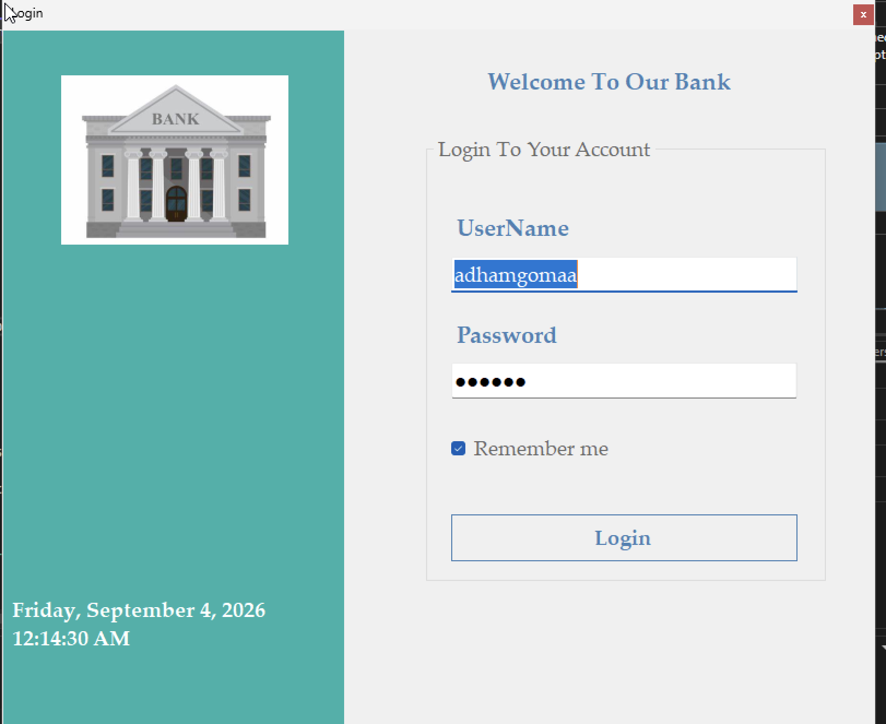
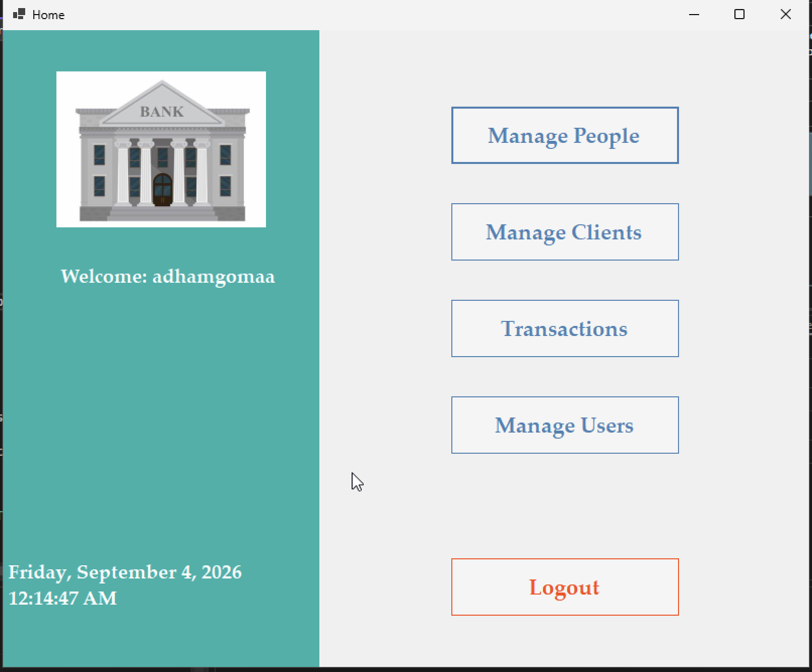
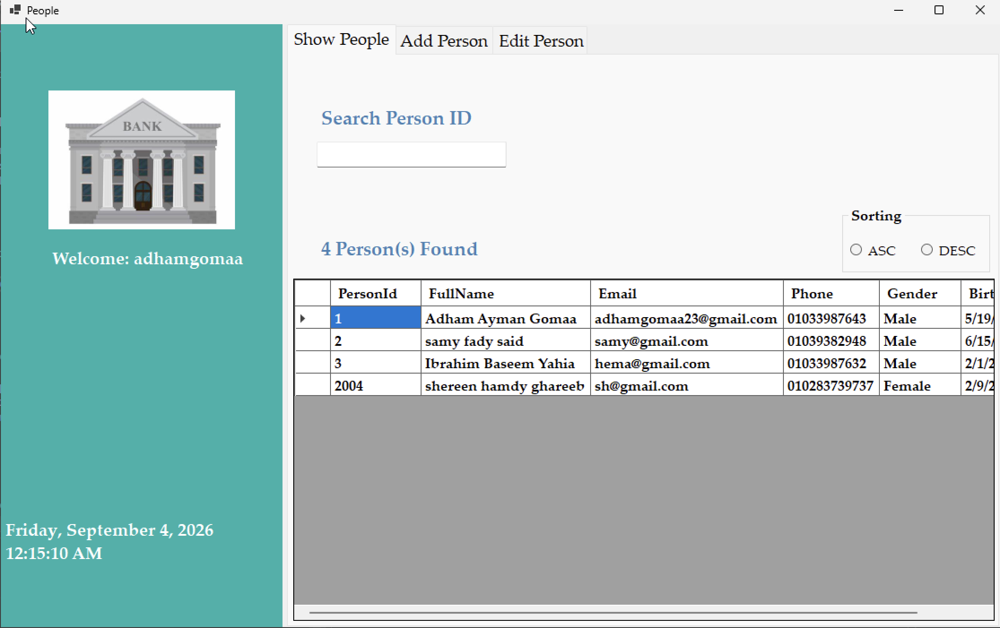
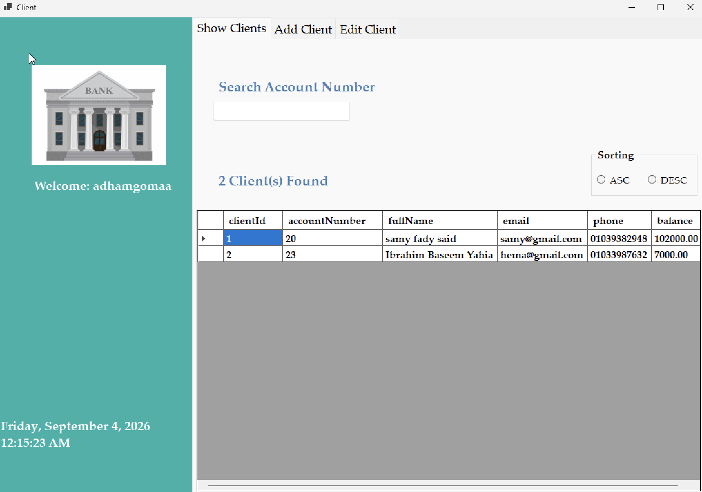
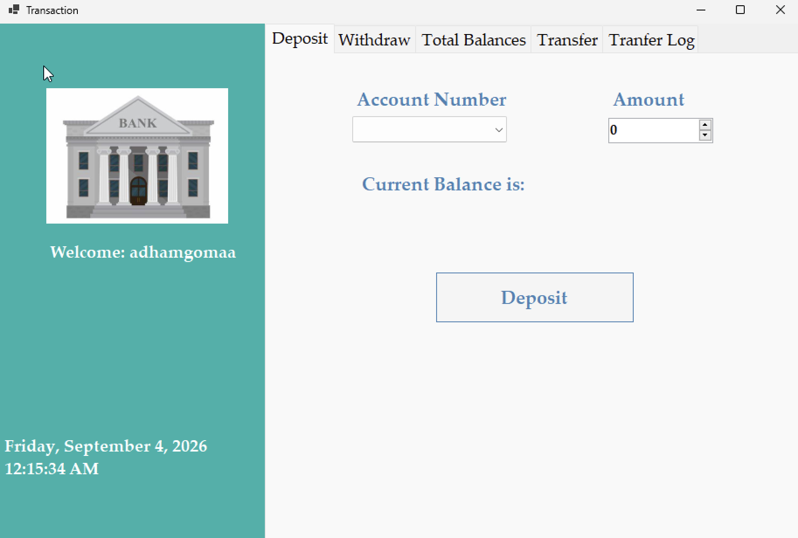
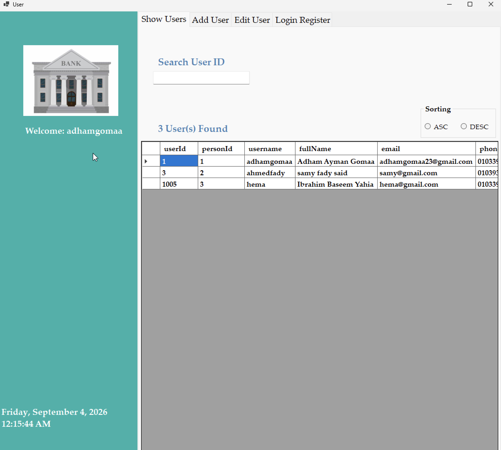

# Bank System v2

<p>
  
  
  
  
  
    
  
  
</p>

Bank System v2 is a two-tier, client-server banking application built with C#, Windows Forms, ASP.NET Core Web API, Entity Framework Core, and SQL Server.

The WinForms desktop application provides the operator interface, while the API owns authentication, authorization, business workflows, validation, and database access. Version 2 separates presentation, API, business, data access, DTO, and shared-domain concerns instead of allowing the desktop client to communicate directly with SQL Server.

> **Platform:** The server targets cross-platform .NET 8, while the Windows Forms client requires Windows and .NET 8.

---

## Table of Contents

- [Overview](#overview)
- [Key Features](#key-features)
- [Architecture](#architecture)
- [Request and Authentication Flow](#request-and-authentication-flow)
- [Technology Stack](#technology-stack)
- [Project Structure](#project-structure)
- [API Reference](#api-reference)
- [Database](#database)
- [Security](#security)
- [Getting Started](#getting-started)
- [Running the Application](#running-the-application)
- [Screenshots](#screenshots)
- [Contributing](#contributing)
- [Author](#author)

---

## Overview

The application supports common employee workflows for a bank:

- Maintain people records.
- Create and administer system users.
- Create and maintain client bank accounts.
- Perform deposits and withdrawals.
- Transfer funds between accounts.
- Review transfer history.
- Review recent login attempts.
- Restrict forms and API endpoints using granular permissions.

The system is intended as a learning and portfolio project that demonstrates:

- A Windows Forms presentation layer.
- A RESTful ASP.NET Core API.
- JWT access tokens and rotating refresh tokens.
- Permission-based authorization.
- Entity Framework Core data access.
- SQL Server stored procedures and database relationships.
- Separation of concerns through interfaces and service projects.

---

## Key Features

### People Management

- Create, view, update, search, and delete person records.
- Store name, email, phone, gender, and birth date.
- Use the same person identity as the basis for client and user records.

### User Administration

- Add, update, activate, deactivate, and delete users.
- Search users by ID or username.
- List users with person and permission information.
- Hash passwords with BCrypt before persistence.
- Attach a user to a person record.

### Client Account Management

- Create client accounts linked to people.
- Search clients by ID or account number.
- Update account details and PIN codes.
- View individual and aggregate balances.
- Perform deposit and withdrawal operations.
- Validate account existence before operations.

### Transfers

- Transfer funds between two existing accounts.
- Deduct from the sender and credit the receiver as one transaction.
- Reject transfers when either account is missing or sender funds are insufficient.
- Record sender, receiver, amount, date, and creating user.

### Authentication and Auditing

- Authenticate users through `POST /api/Auth/login`.
- Issue short-lived JWT access tokens.
- Issue long-lived opaque refresh tokens stored by SHA-256 hash.
- Refresh and rotate sessions automatically.
- Revocation of token families on logout or refresh-token reuse.
- Record successful and failed login attempts with username, timestamp, user ID, and IP address.

### Permission-Based Desktop Navigation

The WinForms home screen displays module buttons only when the current user's JWT permission claim satisfies the required permission.

| Permission | Value | Typical module |
|---|---:|---|
| `People` | `1` | People management |
| `Client` | `2` | Client/account management |
| `Transfer` | `4` | Transfers and transaction history |
| `Registration` | `8` | Login attempt history |
| `User` | `16` | User administration |
| `FullAccess` | `-1` | Administrative operations |

Permissions use a flags-based model. A user may receive a combination of module permissions, and `FullAccess` grants all operations.

---

## Architecture

```text
┌──────────────────────────────────────┐
│         WinForms Desktop Client      │
│     Forms, HttpClient, UI state     │
└──────────────────┬───────────────────┘
                   │ HTTPS / JSON / JWT
                   ▼
┌──────────────────────────────────────┐
│        ASP.NET Core Web API          │
│  Controllers, JWT auth, policies,    │
│  CORS, Swagger, rate limiting         │
└──────────────────┬───────────────────┘
                   │
                   ▼
┌──────────────────────────────────────┐
│            Business Layer            │
│  Interfaces, services, BCrypt,       │
│  refresh-token orchestration         │
└──────────────────┬───────────────────┘
                   │
                   ▼
┌──────────────────────────────────────┐
│          Data Access Layer           │
│   EF Core DbContext and repository   │
│   implementations using LINQ        │
└──────────────────┬───────────────────┘
                   │
                   ▼
┌──────────────────────────────────────┐
│             SQL Server               │
│ BankSystemData tables and procedures │
└──────────────────────────────────────┘
```

### Solution Responsibilities

| Project | Responsibility |
|---|---|
| `BankSystem.WinForms` | Desktop UI, API routes, HttpClient handlers, session state, permission checks |
| `BankSystem.API` | HTTP controllers, middleware, JWT configuration, authorization policies, rate limiting |
| `BankSystem.Business` | Domain services, password hashing, refresh-token rules, and use-case coordination |
| `BankSystem.DataAccess` | Entity Framework Core mappings and SQL persistence implementations |
| `BankSystem.DTOs` | JSON request and response contracts shared with the WinForms client |
| `BankSystem.Shared` | Domain entities and cross-layer models |

Interfaces are used for the API, business, and data-access boundaries, enabling service replacement and scoped dependency injection in `Program.cs`.

---

## Request and Authentication Flow

### Login

1. The WinForms client posts a username and password to `/api/Auth/login`.
2. The API records the attempt and looks up the user.
3. The API verifies that the user is active and validates the BCrypt password hash.
4. A JWT access token is created with:
   - User ID
   - Username
   - Permission value
   - Issuer
   - Audience
   - Expiration
5. The API generates an opaque refresh token and stores only a SHA-256 hash in SQL Server.
6. The WinForms client stores the tokens in memory and derives the current user from JWT claims.

### Protected API Calls

The WinForms `AuthTokenHandler` attaches the access token to outbound requests. If the API returns `401 Unauthorized`, the handler attempts one refresh:

1. Send the stored refresh token to `/api/Auth/refresh`.
2. Validate, rotate, and persist the new refresh token.
3. Build a new access token.
4. Retry the original request once with the new access token.
5. Clear the local session if refresh or retry authorization fails.

The API validates:

- Issuer
- Audience
- Lifetime
- Signing key
- Signed-token requirement
- Allowed HMAC SHA-256 algorithm

### Logout

Logout sends the refresh token to `/api/Auth/logout`. The API revokes the token family. The client then clears local session state. If server logout fails, the desktop application still clears the local session and presents a warning.

---

## Technology Stack

| Area | Technologies |
|---|---|
| Language | C# |
| Desktop UI | Windows Forms, .NET 8 |
| API | ASP.NET Core Web API |
| Security | JWT bearer authentication, BCrypt.Net, SHA-256 refresh-token hashing |
| Authorization | Custom permission requirements and authorization handler |
| Data access | Entity Framework Core 8, SQL Server provider |
| Database | Microsoft SQL Server |
| API documentation | Swagger/OpenAPI |
| Client communication | `HttpClient`, `HttpMessageHandler`, JSON |
| Configuration | `appsettings.json`, environment variables, user secrets |
| Source control | Git and GitHub |

---

## Project Structure

```text
BankSystem-v2/
├── BankSystem.Client/
│   ├── BankSystem.Client.sln
│   └── BankSystem.WinForms/
│       ├── Forms/
│       ├── Helpers/
│       ├── Services/
│       ├── Properties/
│       ├── Images/
│       ├── appsettings.json
│       └── BankSystem.WinForms.csproj
├── BankSystem.Server/
│   ├── BankSystem.Server.sln
│   ├── BankSystem.API/
│   │   ├── Authorization/
│   │   ├── Configuration/
│   │   ├── Controllers/
│   │   ├── Implementations/
│   │   ├── Interfaces/
│   │   ├── appsettings.json
│   │   └── Program.cs
│   ├── BankSystem.Business/
│   ├── BankSystem.DataAccess/
│   ├── BankSystem.DTOs/
│   └── BankSystem.Shared/
├── Database/
│   └── database.sql
├── Screenshots/
├── .gitignore
└── README.md
```

---

## API Reference

The API is protected with JWT bearer authentication unless an endpoint is explicitly marked anonymous.

| Module | Route | Operations |
|---|---|---|
| Authentication | `/api/Auth` | Login, refresh, logout |
| People | `/api/People` | List, get, create, update, delete, existence check |
| Users | `/api/User` | List, get, create, update, delete, username lookup |
| Clients | `/api/Client` | Account CRUD, balance lookup, deposits, withdrawals |
| Transfers | `/api/Transfer` | Create transfer and list history |
| Login auditing | `/api/Registration` | Read recent login attempts |

### Authentication

```http
POST /api/Auth/login
Content-Type: application/json

{
  "UserName": "username",
  "Password": "password"
}
```

The response contains an access token and refresh token:

```json
{
  "AccessToken": "<jwt>",
  "RefreshToken": "<opaque-refresh-token>"
}
```

### Protected Request

```http
Authorization: Bearer <jwt>
```

Swagger is available in the Development environment at `/swagger`.

### Representative Endpoint Groups

| Area | Example endpoints |
|---|---|
| People | `GET /api/People/All`, `GET /api/People/{id}`, `POST /api/People`, `PUT /api/People/{id}` |
| Clients | `GET /api/Client/All`, `GET /api/Client/AccountNumber/{accountNumber}`, `PUT /api/Client/Deposit` |
| Users | `GET /api/User/All`, `GET /api/User/username/{username}`, `POST /api/User`, `PUT /api/User/{id}` |
| Transfers | `GET /api/Transfer/All`, `POST /api/Transfer` |
| Auditing | `GET /api/Registration/LoginAttempts?take=50` |

---

## Database

The repository includes a SQL Server script at `Database/database.sql`. The script is stored as UTF-16 text and contains database creation, tables, constraints, views, and authentication-related procedures.

The main modeled data areas are:

| Area | Information stored |
|---|---|
| People | Name, email, phone, gender, birth date |
| Users | Person link, username, BCrypt password, permission flags, active status |
| Clients | Person link, account number, PIN code, balance |
| Transfers | Sender account, receiver account, amount, date, creating user |
| Refresh tokens | User, token hash, family, expiration, replacement, and revocation |
| Login attempts | Username attempted, user ID, success, UTC time, client IP |

Database behavior also includes:

- Unique constraints on usernames and account numbers.
- Foreign-key relationships between people, users, clients, and transfers.
- Refresh-token family and replacement relationships.
- Stored procedures for login attempt and refresh-token operations.
- EF Core transaction handling for transfer and refresh operations.

The database and EF Core model use SQL Server naming and types such as `decimal(10,2)`, `datetime`, `datetime2`, and SQL Server indexes.

---

## Security

The API implements:

- JWT signature and claims validation.
- BCrypt password hashing.
- Random refresh-token generation.
- SHA-256 refresh-token storage.
- Refresh-token rotation and reuse detection.
- Token-family revocation on suspicious reuse or logout.
- Custom per-user permission authorization.
- Login attempt auditing.
- Fixed-window rate limiting.
- HTTPS redirection and HSTS outside Development.
- CORS allow-list configuration.
- Short-lived access tokens and configurable refresh lifetime.
- Strong startup validation for missing or weak JWT signing keys.

Recommended production practices include:

- Store the SQL Server credentials outside source control.
- Store `Jwt:SigningKey` in a secret manager or environment variables.
- Use HTTPS certificates trusted by the desktop client.
- Restrict CORS origins to deployed client origins.
- Encrypt or isolate refresh-token data and database backups.
- Rotate the JWT signing key through a controlled deployment process.
- Never expose SQL Server directly to untrusted networks.
- Replace example/development credentials before sharing or deploying.

Login is limited to five attempts per IP for a five-minute window. Refresh requests are limited to ten per minute, user-write operations to ten per minute, and the global API limit is 120 requests per minute.

---

## Getting Started

### Prerequisites

- Windows 10 or later for the WinForms client.
- .NET 8 SDK.
- Visual Studio 2022 or `dotnet` CLI support.
- SQL Server or SQL Server Express.
- SQL Server Management Studio or another SQL script runner.

### 1. Clone the repository

```bash
git clone https://github.com/adhamgomaa/BankSystem-v2.git
cd BankSystem-v2
```

### 2. Create the database

Open `Database/database.sql` in SQL Server Management Studio and execute it against the SQL Server instance.

The application and scripts use the database name:

```text
BankSystemData
```

Because the script is UTF-16, use an editor or SQL tool that detects the file encoding before execution.

### 3. Configure the API

Set the SQL Server connection string using the local environment or .NET user secrets. Do not commit production credentials.

From the API directory:

```bash
cd BankSystem.Server/BankSystem.API
dotnet user-secrets init
dotnet user-secrets set "ConnectionStrings:DefaultConnection" "Server=localhost,1433;Database=BankSystemData;User Id=<username>;Password=<password>;TrustServerCertificate=True;"
dotnet user-secrets set "Jwt:SigningKey" "<random-secret-at-least-32-utf8-bytes>"
```

The API also supports environment variables using ASP.NET Core configuration syntax. For example:

```bash
export Jwt__SigningKey="<random-secret-at-least-32-utf8-bytes>"
export ConnectionStrings__DefaultConnection="Server=localhost,1433;Database=BankSystemData;User Id=<username>;Password=<password>;TrustServerCertificate=True;"
```

Default JWT settings are:

```json
{
  "Issuer": "BankSystemAPI",
  "Audience": "BankSystemClient",
  "AccessTokenMinutes": 30,
  "RefreshTokenDays": 7
}
```

### 4. Configure the WinForms client

The client reads `ApiSettings:BaseUrl` from:

```text
BankSystem.Client/BankSystem.WinForms/appsettings.json
```

The default configuration is:

```json
{
  "ApiSettings": {
    "BaseUrl": "https://localhost:7014/api/"
  }
}
```

Update this URL if the API runs on a different HTTPS port.

---

## Running the Application

### Run the API

Using Visual Studio:

1. Open `BankSystem.Server/BankSystem.Server.sln`.
2. Set `BankSystem.API` as the startup project.
3. Select the `https` launch profile.
4. Start the application.

Using the CLI:

```bash
dotnet run --project BankSystem.Server/BankSystem.API/BankSystem.API.csproj --launch-profile https
```

The configured launch profile exposes:

- HTTPS: `https://localhost:7014`
- HTTP: `http://localhost:5243`
- Swagger: `https://localhost:7014/swagger`

### Run the WinForms client

Using Visual Studio on Windows:

1. Open `BankSystem.Client/BankSystem.Client.sln`.
2. Set `BankSystem.WinForms` as the startup project.
3. Start the application.

Using the CLI on Windows:

```bash
dotnet run --project BankSystem.Client/BankSystem.WinForms/BankSystem.WinForms.csproj
```

Start the API before the desktop client. Log in with a user account inserted or registered through the application, subject to the user's permissions.

---

## Screenshots

### Login



### Home



### People



### Clients



### Transactions



### Users



---

## Contributing

1. Fork the repository.
2. Create a focused feature branch.
3. Follow the existing project layout:
   - API concerns in `BankSystem.API`
   - business rules in `BankSystem.Business`
   - persistence in `BankSystem.DataAccess`
   - transport contracts in `BankSystem.DTOs`
4. Do not commit SQL credentials or JWT signing keys.
5. Build the affected server and client projects before opening a pull request.

---

## Author

**Adham Gomaa**

- GitHub: [github.com/adhamgomaa](https://github.com/adhamgomaa)
- Repository: [github.com/adhamgomaa/BankSystem-v2](https://github.com/adhamgomaa/BankSystem-v2)

If this project helped you understand .NET client-server architecture or banking workflow design, consider giving the repository a star.